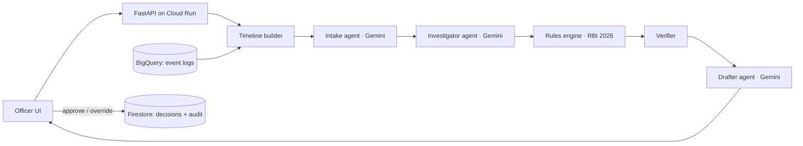

# ARQON: AI case officer for digital-fraud compensation

**Google Cloud AI Builder Cup 2026 · BFSI: Intelligent Risk, Fraud & Financial Experiences · Team ARQON**

From 1 January 2027, RBI's amended directions on customer liability in fraudulent electronic banking transactions require every Indian bank to:

- give **zero liability** for bank negligence, and for third-party breaches reported within 5 calendar days;
- **prove** customer liability (the burden of proof is on the bank);
- pay **small-value compensation** of 85% of net loss, capped at ₹25,000, for losses up to ₹50,000 reported to the bank and to 1930 within 5 days;
- resolve complaints within **45 days** (60 if cross-border).

Banks will face lakhs of these claims. Today an officer rebuilds each case by hand from a dozen log systems. **ARQON does it in seconds and shows its work.** The officer still makes the final call.

## What it does

1. **Evidence timeline.** Merges login, device, SIM, OTP, authentication, transaction, alert, liveness and complaint records into one chronology, and marks the **break point**: the first moment control was lost.
2. **Investigator agent (Gemini).** Reads the timeline and the complaint, proposes a liability category, and explains why. Every claim cites an event ID.
3. **Rules engine (code).** Applies the RBI rules deterministically: reporting windows, ₹50,000 cap, 85% / ₹25,000 formula, losses after reporting, burden of proof.
4. **Verifier.** Checks that every ID the AI cites exists, and that the AI and the rules engine agree. A disagreement or a hallucinated citation sends the case to manual review.
5. **Missing-information checklist.** Blocks approval until gaps (for example, a missing authentication log) are filled or consciously waived.
6. **Drafter agent (Gemini).** Writes the decision letter with an evidence annex.
7. **Human in the loop.** The officer approves, overrides with a reason, or requests information. Every action is written to an audit trail in Firestore.

**Design principle:** Gemini investigates and explains; deterministic code decides amounts. Compliance outcomes are reproducible and auditable, and the AI is checked rather than trusted.

## Architecture



| Layer | Google Cloud |
| --- | --- |
| Models | Gemini (Flash) via Vertex AI, using the Google Gen AI SDK with structured JSON output |
| Runtime | Cloud Run (container built by Cloud Build) |
| Evidence store | BigQuery (`arqon.events`, `arqon.cases`) |
| Decisions and audit | Firestore |

## Evaluation

There are 8 labelled scenarios, each with a known correct outcome:

1. SIM swap
2. Fake KYC call with partial recovery
3. Payment-aggregator breach reported late
4. Remote-access app scam with a loss after reporting
5. Bank failed to update a mobile number
6. Missing authentication log
7. Phishing with no 1930 complaint yet
8. Genuine transaction disputed

`python scripts/run_evals.py` scores each one on three things:

- **Decision accuracy:** outcome and amounts
- **AI classification accuracy:** the investigator's proposed category
- **Citation validity:** the share of AI-cited events that exist

The same report is available in the app under **Eval report**.

## Run locally (Windows)

```powershell
copy .env.example .env      # add GEMINI_API_KEY from aistudio.google.com
.\scripts\run_local.ps1     # open http://localhost:8080
```
Without a key, the app runs in offline mode: the rules engine plus templates, so the demo never breaks.

## Deploy to Google Cloud

```powershell
gcloud auth login
.\scripts\setup_gcp.ps1 -Project YOUR_PROJECT_ID     # APIs, Firestore, BigQuery load, IAM
.\scripts\deploy.ps1   -Project YOUR_PROJECT_ID     # builds and deploys to Cloud Run, prints the URL
```

## Repository

```
app/            FastAPI app, agents, rules engine, timeline, UI (static/)
data/           generate.py (synthetic cases), cases.json, rules.json, bq/ (BigQuery load files)
scripts/        run_local, setup_gcp, deploy, run_evals
tests/          rules engine tests
```

## Notes and limits

- All customer data is synthetic. The rule summaries come from public reporting on RBI's 24 June 2026 amendment directions. Paragraph references should be checked against the RBI originals before production use.
- **Roadmap:**
  - Live connectors to bank log systems
  - Face-liveness results as standard evidence
  - Inter-bank reimbursement claims to RBI
  - Hindi and regional-language letters
  - Agent orchestration on Vertex AI Agent Engine / ADK
